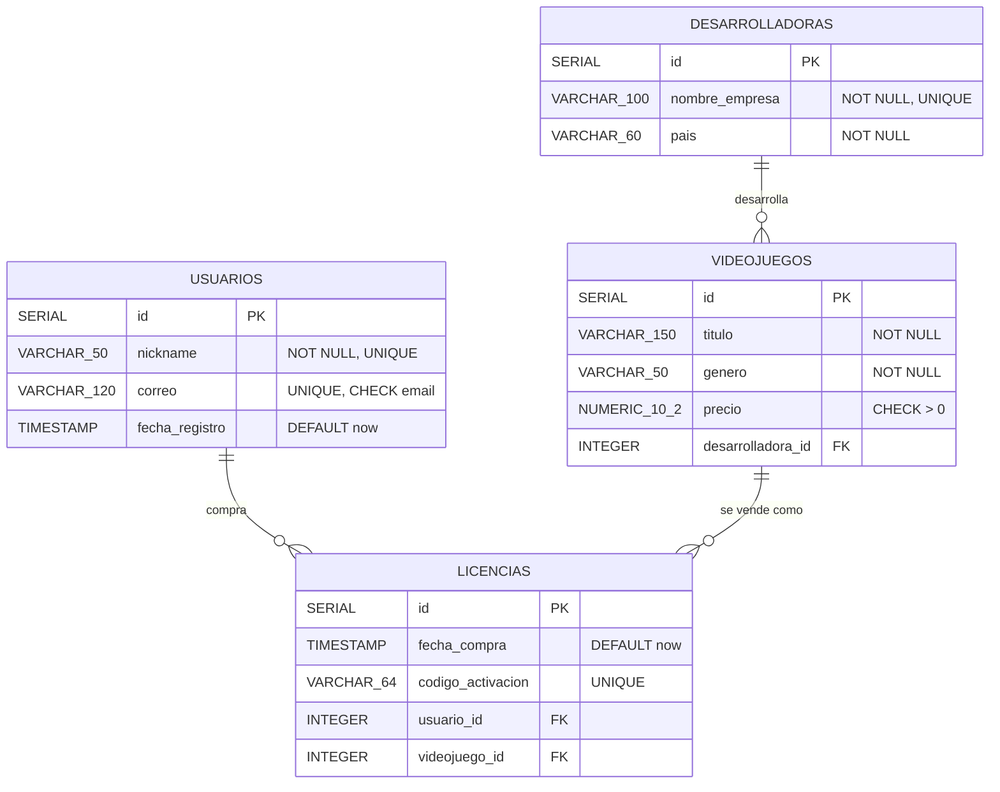

# 🎮 API Tienda Digital de Videojuegos

API REST para una tienda digital de venta de videojuegos con gestión de licencias y usuarios.
**Stack:** Node.js · Express · PostgreSQL (`pg` + Pool) · Swagger OpenAPI 3.0

## 📁 Estructura del proyecto

```
tienda-videojuegos-api/
├── index.js                 # Servidor Express + swaggerOptions + montaje de rutas
├── db.js                    # Pool de conexión a PostgreSQL
├── routes/                  # Un archivo por tabla, cada uno con express.Router()
│   ├── desarrolladoras.js
│   ├── videojuegos.js
│   ├── usuarios.js
│   └── licencias.js
├── utils/
│   └── errores.js           # Traduce errores de PostgreSQL a códigos HTTP
├── database/
│   └── schema.sql           # CREATE TABLE + 10 INSERT por tabla
├── .env.example
├── .gitignore
└── package.json
```

## 🗂️ Diagrama Entidad-Relación



- **Desarrolladoras 1 : N Videojuegos** — una empresa publica muchos juegos.
- **Usuarios 1 : N Licencias** — un usuario puede comprar muchas licencias.
- **Videojuegos 1 : N Licencias** — un juego se vende muchas veces.
- `licencias` resuelve la relación **N:M** entre usuarios y videojuegos (la "biblioteca" de cada usuario).
- Todas las FK usan `ON DELETE RESTRICT`: no se puede borrar una desarrolladora con juegos ni un juego/usuario con licencias (la API responde **409**).

## 🐧 Instalación en Linux (Omarchy / Arch)

### 1. PostgreSQL
```bash
sudo pacman -S --needed nodejs npm postgresql
sudo -iu postgres initdb -D /var/lib/postgres/data      # solo la primera vez
sudo systemctl enable --now postgresql
sudo -u postgres psql -c "ALTER USER postgres PASSWORD 'postgres';"
sudo -u postgres createdb tienda_videojuegos
```
Después, en **pgAdmin → Query Tool** (conectado a `tienda_videojuegos`) abre y ejecuta `database/schema.sql`.
Alternativa por terminal:
```bash
psql -h localhost -U postgres -d tienda_videojuegos -f database/schema.sql
```

### 2. Proyecto Node.js (desde cero, para la captura del manual)
```bash
mkdir tienda-videojuegos-api && cd tienda-videojuegos-api
npm init -y
npm install express pg cors swagger-ui-express swagger-jsdoc dotenv
mkdir routes utils database
code .
```

### 2-bis. Si ya tienes esta carpeta
```bash
cd tienda-videojuegos-api
npm install
cp .env.example .env      # ajusta DB_PASSWORD si es distinto
npm run dev               # o: npm start
```
- API: http://localhost:3000
- Swagger UI: http://localhost:3000/api-docs
- Especificación JSON: http://localhost:3000/api-docs.json (se puede importar en Hoppscotch)

## 🔌 Endpoints

| Recurso | GET (lista) | GET /:id | POST | PUT /:id | DELETE /:id |
|---|---|---|---|---|---|
| `/api/desarrolladoras` | `?pais=` | ✔ | ✔ | ✔ | ✔ |
| `/api/videojuegos` | `?genero=&desarrolladora_id=` | ✔ | ✔ | ✔ | ✔ |
| `/api/usuarios` | `?nickname=` | ✔ | ✔ | ✔ | ✔ |
| `/api/licencias` | `?usuario_id=` | ✔ | ✔ | ✔ | ✔ |

Códigos de respuesta: `200` OK · `201` creado · `400` datos inválidos · `404` no existe · `409` duplicado o registro en uso · `500` error del servidor.

## 🧪 Pruebas en Hoppscotch

En Hoppscotch, en la pestaña **Body** elige `application/json`.

### Desarrolladoras
```http
POST http://localhost:3000/api/desarrolladoras
```
```json
{ "nombre_empresa": "Valve Corporation", "pais": "Estados Unidos" }
```
```http
PUT http://localhost:3000/api/desarrolladoras/11
```
```json
{ "nombre_empresa": "Valve", "pais": "Estados Unidos" }
```

### Videojuegos (demo CRUD completa sugerida)
1. **Ver lo que hay:** `GET http://localhost:3000/api/videojuegos`
2. **Crear:** `POST http://localhost:3000/api/videojuegos`
   ```json
   { "titulo": "Hollow Knight Silksong", "genero": "Metroidvania", "precio": 399.00, "desarrolladora_id": 10 }
   ```
3. **Actualizar otro:** `PUT http://localhost:3000/api/videojuegos/5`
   ```json
   { "titulo": "Elden Ring - Shadow of the Erdtree Edition", "genero": "RPG", "precio": 1499.00, "desarrolladora_id": 5 }
   ```
4. **Eliminar el creado:** `DELETE http://localhost:3000/api/videojuegos/11`
   (Los juegos 1–10 tienen licencias vendidas: borrarlos devuelve 409, lo cual también sirve para mostrar la integridad referencial).

### Usuarios
```http
POST http://localhost:3000/api/usuarios
```
```json
{ "nickname": "samus_aran", "correo": "samus.aran@gmail.com" }
```
```http
PUT http://localhost:3000/api/usuarios/1
```
```json
{ "nickname": "dark_link_pro", "correo": "darklink.pro@gmail.com" }
```

### Licencias
```http
POST http://localhost:3000/api/licencias
```
```json
{ "usuario_id": 3, "videojuego_id": 5 }
```
(El `codigo_activacion` se genera solo, p. ej. `1537-9F99-65EA-A513`; también puedes enviarlo tú.)
```http
PUT http://localhost:3000/api/licencias/1
```
```json
{ "usuario_id": 2, "videojuego_id": 9, "codigo_activacion": "BG3L-GIFT-2026-PQXZ" }
```

### Casos de error útiles para la defensa
```json
{ "titulo": "Juego gratis", "genero": "Acción", "precio": 0, "desarrolladora_id": 1 }
```
→ `400` (precio debe ser > 0)
```json
{ "nickname": "nuevo", "correo": "esto-no-es-correo" }
```
→ `400` (formato de correo)
```json
{ "usuario_id": 999, "videojuego_id": 1 }
```
→ `400` (la llave foránea no existe)

## 📦 Entrega
Antes de comprimir, borra `node_modules/` (se regenera con `npm install`). No subas tu `.env`.
